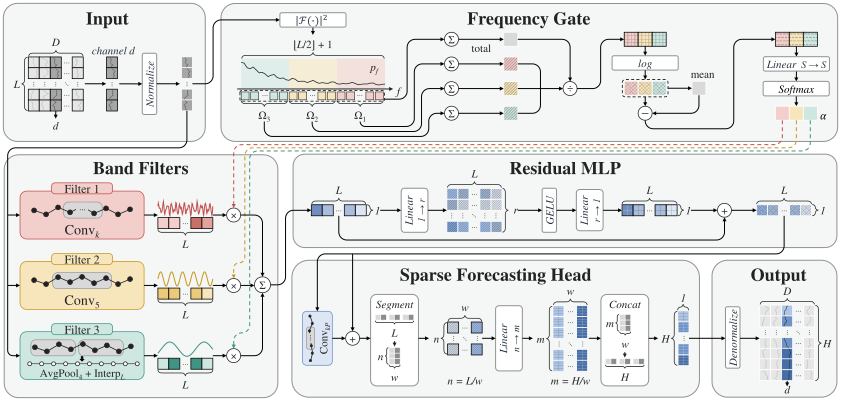

# FEATHer

Official code of **FEATHer**, a lightweight model for long-horizon multivariate forecasting that runs on a
microcontroller (MCU) next to the machine.

> Paper: *FEATHer: Lightweight long-horizon forecasting on microcontrollers for manufacturing systems* (under review).
> Preprint: [arXiv:2601.11350](https://arxiv.org/abs/2601.11350).

The repository holds the model, the size-budgeted comparison with lightweight forecasting models, and the float32 C
ports used to measure each model on the boards (NUCLEO-F103RB as the reference device: Cortex-M3, 128 KB flash, 20 KB
SRAM, no FPU; NUCLEO-F411RE for latency with an FPU).

<p align="center">
  
</p>

## Model

Each channel is forecast with the same weights.

```
normalization -> band filters: Conv_k | Conv_5 | AvgPool_4 + Interp_L
              -> frequency gate (band weights from the input spectrum) -> weighted band sum
              -> residual MLP -> sparse forecasting head -> denormalization
```

Training loss = MSE + a band-separation term. The sparse forecasting head follows SparseTSF.
Code: `baselines/FEATHer/`, configuration: `configs/FEATHer.yaml`.

## Repository

```
run.py                  single entry point: plans and runs only what is missing (--check shows the plan)
scripts/train.py        training worker (one model x dataset x horizon, a list of seeds)
configs/<Model>.yaml    model defaults
configs/experiments/    size.yaml (budgets, search space, seeds), tuned.json (settings chosen by tuning)
baselines/              FEATHer and wrappers of the compared models (cloned by setup_baselines.sh)
tools/results/          protocol, tuning (Optuna), search space, budget check, merging of result shards
utils/                  data loading, preprocessing of the industrial datasets, losses, metrics
deployment/board/       C ports, firmware, golden-data export, board runs, streaming replay, tests
```

Results are written to `results/` (created by the runs).

## Installation

Python 3.9 and PyTorch 2.5.1 were used for the paper.

```bash
# 1. PyTorch for your CUDA version: https://pytorch.org/get-started/locally/
pip install -r requirements.txt
# 2. Compared models at the commits used for the paper, into baselines/<Name>/<Name>-main/
bash setup_baselines.sh
```

## Data

| Group | Datasets | Source |
|---|---|---|
| Industrial (6) | Steel, MetroPT3, WindSCADA, N2O, EWELD, BlastFurnace | raw files from UCI, Zenodo, Mendeley, and Figshare (links in `utils/prep_manufacturing.py`), placed in `data/<name>/`, then `python utils/prep_manufacturing.py` |
| Long-term forecasting benchmarks (5) | ETTh1, ETTh2, ETTm1, ETTm2, Weather | downloaded by `darts` on first use |

Gap-filled industrial datasets carry a `mask.csv`; losses and metrics count observed values only.

## Experiments

Input length 96, horizons 96 / 192 / 336 / 720, batch 32, Adam with a cosine schedule, gradient clipping at 1.0;
the test split is evaluated once, with the weights of the best validation epoch.

Two size budgets (tiers): `1k` (at most 1,000 parameters at each horizon) and `chip` (the firmware fits the flash and
SRAM of the F103), on the industrial data; `ltsf1k` and `ltsf` apply them to the benchmarks. Each model is tuned the
same way: one Optuna study (TPE with successive halving) per (tier, model, dataset, horizon) with 40 trained trials;
under the `chip` budget each drawn setting is compiled for the board before it is trained. The chosen setting (lowest
validation MSE) is then trained with five seeds.

```bash
python run.py --stage tune --tier chip --check            # what is missing
python run.py --stage tune --tier chip
python tools/results/tune.py --collect                    # finished studies -> configs/experiments/tuned.json
python run.py --stage final --tier chip                   # chosen settings x 5 seeds, models saved
python run.py --stage ablation                            # FEATHer with one part changed
python tools/results/merge_incoming.py                    # results/_incoming/ -> results/*.csv
```

Runs resume: a finished study or a cell with a result row is skipped.

## Deployment on the MCU

The C port of each model performs the same operations as its PyTorch forward pass, the same number of times, and only
reorders the computation to save memory; Fourier transforms follow pocketfft. Firmware is built with the GNU tools for
STM32 14.3.rel1 (STM32CubeIDE 2.2.0) at `-O2` and needs an STM32CubeIDE project for the board
(see `deployment/board/tools/board_prep.py`).

```bash
# C ports against PyTorch, stage by stage (x86 build)
python deployment/board/export/export_golden_<m>.py [--pred_len H] [--d_model D]
make -C deployment/board test
python deployment/board/test/check_sizes.py

# flash and SRAM of one setting, without a board
python deployment/board/tools/chip_verdict.py --models feather_ci --data MetroPT3 --H 96

# latency on a board
python deployment/board/tools/board_run.py --models FEATHer_core --tiers chip --plan
python deployment/board/tools/board_run.py --models FEATHer_core --tiers chip --board f411 --port <COM>

# supply current of the F103 with an X-NUCLEO-LPM01A (static mode)
python deployment/board/tools/power_run.py --lpm <COM> --out <csv>

# streaming replay of a trained model on the board
python deployment/board/replay/replay_flash.py --model FEATHer_core --H 96
python deployment/board/replay/replay.py --model FEATHer_core --data MetroPT3 --H 96 --port <COM> --every 60
```

Port names `<m>`: `feather`, `stsf`, `stsf_mlp`, `mixlinear`, `fits`, `cmos`, `timebase`, `phaseformer`.

## License

MIT (`LICENSE`). The compared models under `baselines/<Name>/<Name>-main/` keep their own licenses.
